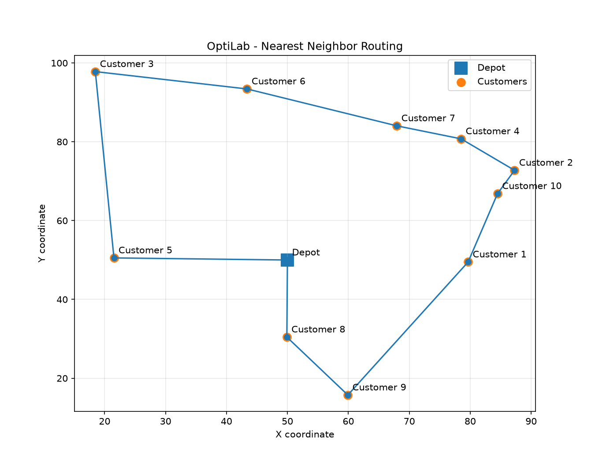

# Project Overview

Optimization project focusing on evaluating several techniques to solve vehicle routing problem: given a depot and some vertices representing customer locations, determine a route that visits all customers once and minimizes the travel distance.

